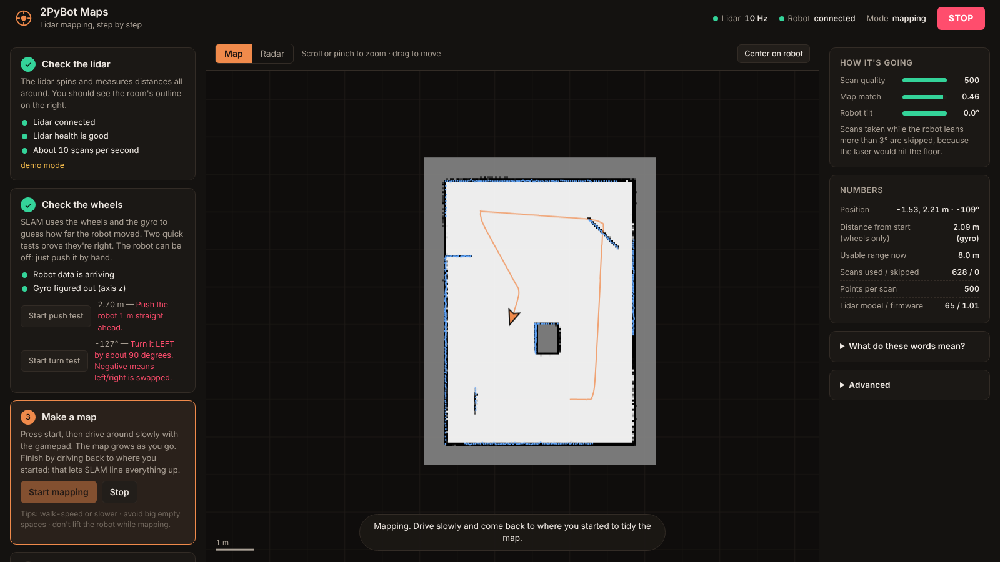

# Lidar mapping (RPLIDAR C1) — standalone, no ROS

Open **http://10.42.0.1:8080/slam/** (single console port). The page walks you
through five steps: check the lidar, check the wheels, make a map, save it, use it.



More screenshots (simulator): [lidar check](images/slam/1_radar_lidar_check.png) ·
[wheel tests](images/slam/2_wheel_tests.png) · [saved + glossary](images/slam/4_saved_with_glossary.png) ·
[localizing](images/slam/5_localizing_on_saved_map.png) · [phone](images/slam/6_phone_landscape.png)

## Wiring (40-pin header, UART4)
| C1 | A7A pin | Signal |
|---|---|---|
| 5 V | 2 or 4 | +5 V |
| GND | 6 | GND |
| TX | 18 | PJ25 / UART4-RX |
| RX | 16 | PJ24 / UART4-TX |

TX/RX cross over. Logic is 3.3 V on both sides; only the C1 supply is 5 V.
Avoid pins 3/5 (I2C bus 7, ToF) and 8/10 (debug console).

### Bot setup (once, both needed)
1. **Enable UART4:** `sudo rsetup enable_overlays sun60iw2p1-uart4.dtbo`
   (or `rsetup` → Overlay → Manage overlays → Enable UART4).
2. **UART clock 96 MHz:** all A733 UARTs run from a 24 MHz crystal by default,
   which cannot make 460800 (the C1's fixed rate; you get ~500000). The overlay
   [`scripts/radxa/overlays/2pybot-uart-pll96m.dts`](../scripts/radxa/overlays/2pybot-uart-pll96m.dts)
   moves them to PLL-PERI0-480M / 5 = 96 MHz (460800 → +0.16 %, 115200 unchanged):
   ```bash
   dtc -@ -q -I dts -O dtb -o /tmp/2pybot-uart-pll96m.dtbo scripts/radxa/overlays/2pybot-uart-pll96m.dts
   sudo install -m 0644 /tmp/2pybot-uart-pll96m.dtbo /boot/dtbo/
   sudo u-boot-update && sudo reboot
   ```
   Undo: `sudo rm /boot/dtbo/2pybot-uart-pll96m.dtbo && sudo u-boot-update && sudo reboot`.
3. Check after reboot: `/dev/ttyAS4` exists and
   `sudo cat /sys/kernel/debug/clk/apb-uart/clk_rate` prints `96000000`.

Verified on the bot (2026-11-17): C1 model 65, firmware 1.02, hardware 18,
health good, 10 Hz, ~400 points per rotation.

## How it works
- `console/lidar_c1.py` — C1 driver (pyserial). Owns only the lidar UART.
- `console/slam/odom_core.py` — wheel + gyro odometry. Finds the vertical gyro
  axis automatically while you spin the robot. The compass is not used.
- `console/slam/grid.py` — 5 cm occupancy grid and a correlative scan matcher (numpy).
- `console/slam/engine.py` — skips scans while the robot leans >3° or rocks
  fast, clips the range where the tilted laser would hit the floor, maps, saves,
  loads and localizes (global search on load and on **Find me**).
- `console/slam_app.py` + `ui/slam/` — the page and API (`/api/state`, `/ws`,
  `/api/mapping/*`, `/api/maps/*`, `/api/relocalize`, `/api/test/*`, `/api/estop`).

It is **listen-only**: it reads raw `O`/`D` lines through
`SerialLink.add_line_listener()` and never sends drive commands. The STOP button
uses the console's normal E-STOP (allowed during firmware maintenance, like the
console and system-map STOP routes). The lidar and SLAM threads start with the
console service and the C1 is sent STOP when the service shuts down.

## Settings (environment)
`BOT_SLAM_PORT` (0 = only `/slam/`; set a port to re-enable a separate server), `BOT_LIDAR_PORT` (`/dev/ttyAS4`),
`BOT_LIDAR_BAUD` (460800), `BOT_LIDAR_RPM` (1200 = 20 Hz on the C1M1R2; 600 = 10 Hz),
`BOT_MAPS_DIR` (`~/.2pybot/maps`), `BOT_LIDAR=0` to
leave the lidar off. Mount numbers and thresholds: `DEFAULTS` in `slam/engine.py`.

## Try it without the robot
`cd software/radxa/console && python -m console.slam_demo` → http://localhost:6970/

## Hardware findings
- 460800 on UART4 needs the 96 MHz clock overlay above (verified).
- The C1 answers legacy `SCAN 0x20` with 5-byte nodes, but only after the HQ
  motor-speed command (`0xA8`); the driver sends it automatically after the first
  empty SCAN (verified, ~1.5 s delay at connect).

## Floor clipping and de-skew
The scan plane is 0.265 m above the floor (measured, upright). Pitch lowers only
the forward/backward beams: a beam at azimuth φ dips `atan(tan θ·cos φ)`, so each
beam is clipped at `0.265 / tan(dip + spread + 0.75°)`; side and rising beams keep
full range. Whole scans are skipped only above 12° lean or 60°/s rocking. Every
point is moved to the mid-scan robot pose using odometry (de-skew).

## Pose fusion
`slam/fusion.py` keeps [x, y, yaw] with a covariance. Wheel distance + gyro yaw
predict it at every scan; noise grows with distance, turning and detected slip
(gyro yaw rate disagreeing with the wheels). A scan match corrects it with a
covariance from the matcher's score surface, only if the score is good and it
passes a 99 % Mahalanobis gate. `/api/state` → `fusion` shows updates, rejected
matches and the 1σ uncertainty.

## ToF 3D layer
`slam/tof_layer.py` projects the VL53L5CX 8×8 frame (0.21 m above the floor)
into the map: points 4–50 cm high are low obstacles (orange), returns more than
6 cm below the floor are drop-offs (red). The sensor's down-tilt is estimated from
floor returns in the bottom rows while the robot balances steadily
(`tof.tilt_confident`). It is kept separate from the lidar map.

## Not verified on hardware yet
1. `lidar_y` (−0.031 m) comes from the CAD assembly.
