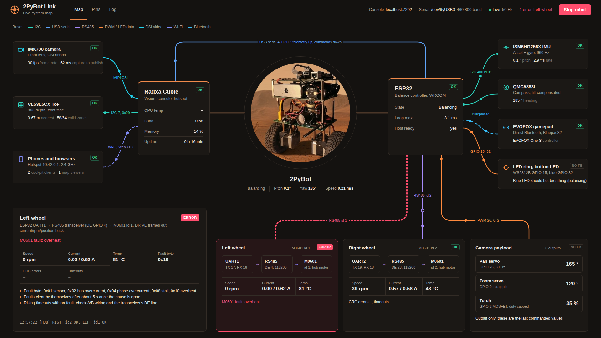
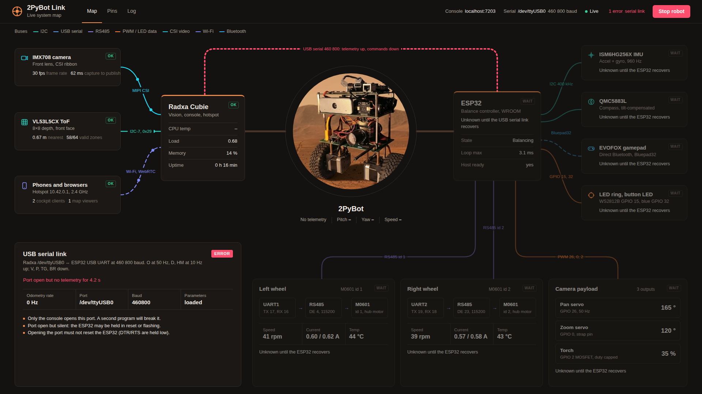
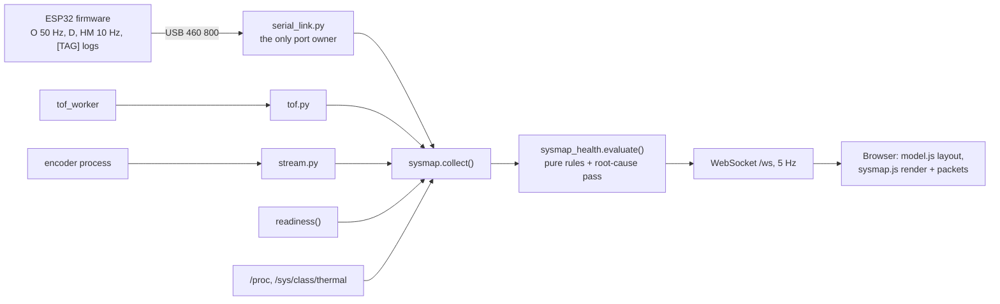

# System map GUI — find the culprit at a glance

`2PyBot Link` is a live map of the whole robot: every board, sensor, motor and
wire drawn where it sits in the real system, each one coloured by its own
health. When something breaks, exactly one block turns red and flashes, the
blocks that depend on it go grey, and the inspector says what failed and what to
check. This document explains the idea, how the 2PyBot implementation works,
and how to build the same kind of interface for any system.



- On the robot: **`http://10.42.0.1:6969`**, or **`http://10.42.0.1:8080/sysmap/`**
- Without a robot: `python -m console.sysmap_demo --scenario cycle`, then `http://localhost:6969`

---

## 1. What kind of interface this is

Industrial control rooms call this a **topology view** or **mimic diagram**:
the screen copies the physical plant, and alarms appear on the part that raised
them. Network monitoring tools use the same idea with **dependency-aware alarm
suppression**. The combination is what makes it good at finding culprits.

A normal dashboard shows numbers grouped by type: a speed chart, a current
chart, a temperature list. You still have to know which number belongs to which
cable and work out which failure caused the others. A topology view answers
three questions in one look:

1. **What is broken?** The red block.
2. **What else is affected?** The grey blocks hanging off it.
3. **Where is it physically?** Its position, its wire, its bus and its pins.

### The five rules that make it work

| Rule | Why it matters |
| :--- | :--- |
| **Layout copies the wiring.** Hubs in the middle, things plugged into them around the edge, chains (driver → bus → motor) drawn as chains. | You read the screen the way you would trace the harness with a finger. |
| **Every block judges itself from its own evidence.** Freshness, limits, explicit fault flags, process state. | A block never turns red because a neighbour failed. |
| **Dependencies suppress downstream alarms.** If the USB link dies, everything known only through it becomes *waiting*, not *error*. | One failure produces one red block, not ten. This is the single most important rule. |
| **Wires carry health too.** Moving dots mean data is arriving; a red dashed wire with no dots means it is not. | Many faults are cables and buses, not chips. |
| **The inspector says what to do.** The reason, the live numbers, the data path, the checks, and the matching log lines. | The person looking at it may not be the person who wrote the firmware. |

---

## 2. Reading the 2PyBot map

### Layout

```
 Radxa leaves        Radxa hub        robot        ESP32 hub         ESP32 leaves
 ┌──────────┐                                                    ┌──────────────┐
 │ IMX708   │──CSI──┐                                          ┌─│ IMU          │
 │ VL53L5CX │──I2C──┤ Radxa ═══════ (photo) ═══════ ESP32 ├────┤─│ QMC5883L     │
 │ Phones   │─WiFi──┘   └──── USB serial over the top ────┘    ├─│ Gamepad (BT) │
 └──────────┘                                                    └─│ LED ring     │
 ┌───────────┐                 ┌──────────┬──────────┬─────────┐ └──────────────┘
 │ Inspector │                 │ L wheel  │ R wheel  │ Payload │
 └───────────┘                 │ UART→485 │ UART→485 │ PWM ×3  │
                               └──────────┴──────────┴─────────┘
```

The thick grey branches from the robot photo to each hub mean "mounted on". The
coloured wires are buses; colour identifies the bus type (legend at top left).
Filled dots travel in the data direction; on two-way links (USB serial,
RS485), the hollow dot is the reply direction.

### Status badges

| Badge | Meaning | Looks like |
| :--- | :--- | :--- |
| **OK** | Fresh data, inside limits | Green outline |
| **WARN** | Working, needs attention | Orange outline, orange reason line |
| **ERROR** | This block's own evidence says it failed. Start here. | Solid red badge, red border flashing about once a second |
| **WAIT** | Cannot be judged: something upstream failed | Dimmed |
| **NO DATA** | No signal has arrived yet | Dimmed |
| **NO FB** | Output-only hardware: commanded, nothing reports back | Grey outline |

The header shows the error count with the failing block names. Clicking it
steps through the errors. Clicking any block or wire opens it in the inspector;
`Esc` returns the inspector to "follow the first error". Flashing stops when the
operating system asks for reduced motion.

### Three worked examples

**USB cable unplugged.** One red block: the serial wire across the top. ESP32,
IMU, compass, gamepad, wheels, payload and lights all show WAIT. The inspector
shows the operating-system error, for example
`could not open port /dev/ttyUSB0: No such file or directory`. The ToF sensor,
camera and phones stay green because they hang off the Radxa, not the serial
link.



**ToF sensor not answering.** One red block on the left: VL53L5CX, "No frame for
2.4 s", with a red dashed I2C wire. The inspector reminds you that an enabled
guard holds forward speed at zero while depth is stale, and to run
`i2cdetect -y 7`.

**Left motor overheats.** The left wheel group flashes red: "M0601 fault:
overheat", 81 °C, current 0.00 of 0.62 A. The right wheel stays green, so the
problem is that motor, not the ESP32 or the shared code path.

### Other tabs

- **Pins**: the ESP32 GPIO map and Radxa interfaces, from `model.js`.
- **Log**: the last 120 console log lines, filterable, with a "problems only"
  switch.

**Stop robot** sends exactly what the console's E-STOP sends (`X` plus stopping
any autonomy route). Nothing on this page can arm the robot.

---

## 3. Architecture



### Why it runs inside the console process

The console already owns everything the map needs: the serial link and its
parsed telemetry, the ToF worker, the video encoder, the readiness probe.
Running the map in the same process means:

- **No second serial owner.** Two programs on `/dev/ttyUSB0` corrupt each
  other's lines. The map only reads the console's objects.
- **No new service.** One-pull deployment restarts the console; the map comes
  with it. No extra systemd unit, nothing new to keep in sync.
- **No proxy, no CORS.** The map reads Python objects, not HTTP.

`server.py`'s `main()` runs two uvicorn servers on one event loop: the console
on `BOT_PORT` (8080) and the map on `BOT_SYSMAP_PORT` (6969). The map's FastAPI
app is also mounted at `/sysmap/` on the console port, so it still works if
6969 is blocked. Three details keep this safe:

1. **One signal handler.** Each uvicorn server normally installs its own
   SIGTERM handler and the second would override the first, leaving the
   console running after systemd asks it to stop. Both servers have signal
   capture disabled and a single handler stops both. Measured shutdown: 0.2 s.
2. **The map can never take the console down.** uvicorn calls `sys.exit()`
   when it cannot bind a port. The map server runs inside a wrapper that
   catches that and logs
   `[console] system map on :6969 stopped: SystemExit(...)`; the console keeps
   serving.
3. **E-STOP passes the maintenance gate.** The console blocks POST requests
   during firmware maintenance. `/sysmap/api/estop` is exempt, like
   `/api/estop`.

### Files

| File | Role |
| :--- | :--- |
| `console/sysmap_health.py` | Pure rules: `evaluate()`, root-cause pass, `EventTracker` log parser. Standard library only. |
| `console/sysmap.py` | `create_app()`: collector, Radxa stats, `/api/snapshot`, `/ws`, `/api/estop`, static files |
| `console/sysmap_demo.py` | Simulated robot with fault scenarios for working without hardware |
| `console/server.py` | Mounts `/sysmap`, runs both ports, exempts the map's E-STOP |
| `console/config.py` | `SYSMAP_PORT` from `BOT_SYSMAP_PORT`, default 6969, `0` disables |
| `ui/sysmap/index.html` | Page shell, tabs |
| `ui/sysmap/model.js` | Static half: positions, wires, bus colours, data paths, checks, pins |
| `ui/sysmap/sysmap.js` | Builds the DOM once, repaints from snapshots, animates packets |
| `ui/sysmap/sysmap.css` | Orange dark theme, status styles, fault flash |
| `ui/sysmap/bot.jpg` | Robot photo, cropped from `assets/2pybot.png` |
| `tests/test_sysmap_health.py`, `tests/test_sysmap_api.py` | Rules, log parsing, HTTP/WS surface |

### Snapshot format

The server does all judging; the browser only draws. One snapshot, trimmed:

```json
{
  "t": 1793620370.2,
  "nodes": {
    "serial":  {"status": "ok", "reason": "Telemetry flowing",
                "metrics": [["Odometry rate", "50 Hz"], ["Port", "/dev/ttyUSB0"]]},
    "wheel_l": {"status": "error", "reason": "M0601 fault: overheat",
                "metrics": [["Speed", "0 rpm"], ["Current", "0.00 / 0.62 A"], ["Temp", "81 °C"]]},
    "imu":     {"status": "blocked", "reason": "Unknown until the ESP32 recovers",
                "own_status": "ok", "metrics": []}
  },
  "summary": {"errors": ["wheel_l"], "warnings": [], "state": "error"},
  "live": {"pitch": 0.3, "yaw": 182.0, "balancing": true, "rx_hz": 50.0},
  "tof_grid": {"distance_mm": [ ... 64 ... ], "valid": [ ... 64 ... ]},
  "log": [{"t": 1793620369.8, "text": "[HUB] LEFT fault 0x10 OVERHEAT"}]
}
```

Metrics arrive as already-formatted `[label, value]` pairs, so units and
rounding live in one place. Non-finite numbers are replaced with `null`
before sending, because `NaN` makes the browser's `JSON.parse` fail.

---

## 4. Health rules on 2PyBot

Each block's evidence and thresholds. All are in `sysmap_health.py`.

| Block | Evidence | ERROR when | WARN when |
| :--- | :--- | :--- | :--- |
| Radxa | `/sys/class/thermal`, load, memory | CPU ≥ 85 °C | CPU ≥ 75 °C, load > 1.5 × cores |
| Camera | encoder process, readiness snapshot age, encoder metrics | encoder stopped; no fresh frame in 5 s | capture to publish > 150 ms |
| ToF | `tof.status()` | worker error; no frame > 0.5 s | starting; every zone invalid |
| Phones | readiness hotspot bind, console WS clients | hotspot address not up | — |
| USB serial | port state, odometry age and rate, open errors in the log | port closed; open but silent > 1 s | firmware maintenance; rate < 25 Hz |
| ESP32 | `BS` startup state, `D` loopMax | startup ERROR; loop > 20 ms (firmware disarms) | still starting; loop > 6 ms |
| IMU | `[IMU] ERROR`, `[MAIN] FATAL` log lines, pitch | init or calibration error since boot | — |
| Compass | heading change over time (inferred) | — | heading frozen ≥ 30 s while moving |
| Gamepad | `[PAD] Connected/Disconnected`, `NR` pad flag | — | disconnected |
| Each wheel | `HM` record age, fault byte, temperature, link/mode flags, `[HUB]` boot probe and counters | HM stale > 1.5 s; any fault bit; reply timeout; ≥ 80 °C | mode not confirmed; ≥ 70 °C; current limit while balancing |
| LEDs, payload | none (output only) | — | — |

**Root-cause tree.** `PARENT` in `sysmap_health.py`:

```
radxa ─┬─ camera
       ├─ tof
       ├─ clients
       └─ serial ── esp32 ─┬─ imu, compass, gamepad, lights
                           └─ wheel_l, wheel_r, payload
```

After every block is judged on its own, a top-down pass replaces the status of
any block whose parent is ERROR or WAIT (or whose parent is the serial link in
maintenance) with WAIT. The original status is kept in `own_status` so you can
see it in the API.

### What the robot cannot tell the map (shown honestly)

- **Compass.** Firmware calls `init()` and never checks it; there is no health
  flag. The map infers trouble only from a frozen heading while moving, and
  the inspector says so.
- **Which wheel lost the link.** `HM` has one `link_ok` for both wheels. The
  map uses the boot probe line `[HUB] RIGHT id2 OK; LEFT id1 NO REPLY` to blame
  the right one. Per-wheel CRC and timeout counters appear only after an `S`
  status print while stopped.
- **Motor temperature while balancing.** Temperatures come from idle queries
  only (see `docs/BLDC_V4.md`); during balancing they are the last idle value.
- **Battery.** There is no voltage sensor and the M0601 does not report bus
  voltage, so there is no battery block. Adding a divider or an INA226 would
  add one (see section 6).
- **Servos, torch, LEDs.** Output only. The map shows the last commanded value
  and, for the blue button LED, the pattern it *should* be showing, so you can
  compare it with the real LED.

---

## 5. Front-end details

- **Two halves.** `model.js` is the static half: where each block sits on a
  fixed 1920 × 1016 stage, its wire path, bus, packet direction, data path text,
  checks and the log pattern that belongs to it. Health is the dynamic half
  from the server. Changing wiring means editing `model.js`; changing rules
  means editing `sysmap_health.py`.
- **Build once, repaint many.** The DOM and SVG are created once at load.
  Each snapshot (every 200 ms) only swaps classes and text. No framework, no
  build step.
- **Packets.** One `requestAnimationFrame` loop moves the dots along each wire
  with `getPointAtLength`. Healthy wires run at full speed, WARN wires at about a
  third, and ERROR/WAIT/NO DATA wires show no dots at all. The dots stand for
  "data is arriving", not the exact message rate.
- **Scaling.** The stage is a fixed canvas scaled to the window (minimum 55 %,
  then it scrolls), so wires and blocks never reflow out of alignment.
- **Offline.** No CDN scripts and no web fonts, because the hotspot has no
  internet. System fonts with tabular numbers keep values from jittering.
- **Lost connection.** If no snapshot arrives for 3 s, a red banner appears, the
  header turns Offline, and every block turns NO DATA. Stale green is worse than
  no answer.
- **Accessibility.** Blocks are focusable buttons (`Enter` selects), the
  inspector is a live region, and the fault flash respects reduced motion.

---

## 6. Adding a block

Example: a battery voltage sensor (INA226 on the ESP32's I2C bus).

1. **Give it a signal.** Firmware must report something the console can parse,
   for example a `PWR,ms,volts,amps` line. Parse it in `serial_link.py` into
   `link.tel["power"]`, with a receive timestamp.
2. **Collect it.** In `sysmap.collect()`, add
   `"power": dict(link.tel.get("power", {}))` and its age.
3. **Judge it.** In `sysmap_health.py`, write `eval_power(power, age)` that
   returns `node(status, reason, metrics)`. Use the battery's own limits (for
   5S Li-ion: warn below 17.5 V under load, error below 16 V). Add it to
   `evaluate()` and set `PARENT["power"] = "esp32"`.
4. **Place it.** In `model.js`, add a `NODES.power` entry with position, title,
   data path, checks and log pattern, and a `WIRES` entry with its path, bus
   and `flow`. Keep the layout rule: it hangs off the hub it is wired to.
5. **Test it.** Add cases to `tests/test_sysmap_health.py` for each threshold
   and for the WAIT case when the serial link is down. Add a scenario to
   `sysmap_demo.py`.

---

## 7. Building one of these for any system

The same method works for a drone, a 3D printer, a home lab or a factory cell.

### Step 1 — Inventory and wiring

List every part that can fail on its own, and every connection between parts.
Draw it on paper the way it is actually wired. That drawing *is* your layout.

### Step 2 — The dependency tree

For each part, ask: "how do I know this part's state?" The answer is its
parent. A sensor read by a microcontroller that talks over USB has the chain
`host → USB link → MCU → sensor`. This tree drives alarm suppression. It is
usually the same as the wiring, but not always: a Wi-Fi client's health is
observed through the hotspot, not through the cable it is plugged into.

### Step 3 — Evidence for each part

Pick evidence the part produces itself, in this order of preference:

1. **An explicit fault flag** from the device (M0601 fault byte, driver status).
2. **Freshness**: how long since its last message, compared with its normal
   rate. This catches dead cables, crashed workers and hung buses.
3. **Limits** on its own values (temperature, loop time, current).
4. **Process state** for software parts (is the encoder running, did it exit).
5. **Inference** only as a last resort, labelled as inferred.

Never mark a part OK just because nothing bad was reported. Output-only parts
get their own status (NO FB here) instead of a false OK.

### Step 4 — One status vocabulary

Keep it small and the same everywhere: ok, warn, error, waiting, no data, no
feedback. Only *error* is allowed to flash. Use colour for the bus type and a
separate, reserved red for faults, so a red line can never be mistaken for a
bus colour.

### Step 5 — Judge on the server, draw in the browser

Put rules in one pure function that takes a plain dict and returns statuses.
It is then easy to unit-test, the browser stays simple, and every client (web,
phone app) sees the same verdict. Stream complete snapshots rather than
deltas; at a few hertz the cost is negligible and a reconnecting client is
immediately correct.

### Step 6 — Layout rules

- Hubs near the centre, their parts around them on the side they connect from.
- Chains drawn left-to-right as chains.
- Wires routed around the centrepiece, never through blocks.
- A fixed design canvas scaled to fit, so geometry stays exact.
- One inspector panel with a fixed place on screen.

### Step 7 — Make failure easy to rehearse

Build a demo mode with named fault scenarios before you need it. It lets you
design the failure screens, test the suppression rules, and train people,
without breaking real hardware.

### Pitfalls

- **Alarm flooding.** Without dependency suppression, one cable fault turns
  half the screen red and hides the cause.
- **Stale data that looks fresh.** Always carry an age with every value and
  judge on it. Show NO DATA when the page itself loses the server.
- **A second owner of a hardware port.** Read from the program that owns the
  port; never open it again from the dashboard.
- **Decoration over signal.** Flashing, glow and motion are for faults only.
- **Unhonest health.** If a part cannot report, say so.

---

## 8. Development and operation

```sh
cd software/radxa/console
python -m pip install -r requirements.txt               # FastAPI + uvicorn, once
python -m console.sysmap_demo --scenario cycle         # healthy, tof, serial, wheel, imu, pad
python -m pytest ../../../tests/test_sysmap_health.py ../../../tests/test_sysmap_api.py -q
```

| Setting | Default | Effect |
| :--- | :--- | :--- |
| `BOT_SYSMAP_PORT` | `6969` | Map port. `0` disables the separate port; `/sysmap/` on the console port still works. |

The page is plain HTML, CSS and JavaScript modules served from
`ui/sysmap/`, so front-end edits need only a browser refresh. Python edits need
a console restart (`sudo systemctl restart 2pybot-console`).

**If the map does not load:**

- Port 6969 refused, `:8080/sysmap/` works: something else holds 6969. The
  console log has `[console] system map on :6969 stopped: ...`.
- Page loads but shows "Lost connection": the WebSocket is blocked or the
  console restarted; it retries every few seconds.
- Everything WAIT behind a red serial wire: that is the map working. Fix the
  USB link first.
